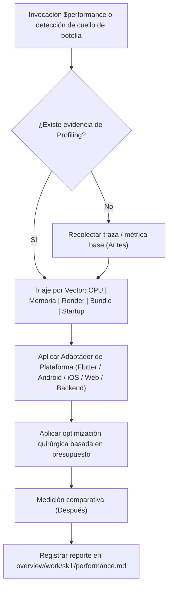

# ⚡ Performance Agent Skill

> **Habilidad Transversal de Rendimiento, Optimización de Memoria y Diagnóstico Multi-Plataforma para Agentes de IA.**  
> Esta skill es **Transversal** (principios y metodología agnósticos) con adaptadores especializados por plataforma (Flutter, Android, iOS, Web, Backend).

---

## 📌 Propósito y Alcance

1. ⚡ **CPU & Concurrencia**: Detección de bloqueos en hilo principal, offloading de tareas pesadas, workers/isolates y concurrencia eficiente.
2. 🧠 **Gestión de Memoria**: Auditoría de fugas de referencia, spikes de memoria, retención indebida de bitmaps y control de caches.
3. 🎨 **Renderizado & Frame Budget**: Diagnóstico de caídas de frames (jank), sobre-dibujado (overdraw), layout thrashing y recomposiciones innecesarias.
4. 📦 **Assets & Bundle Budget**: Optimización de peso de binarios, compresión de imágenes, lazy loading y empaquetado.
5. 🚀 **Startup & Latencia de Red**: Reducción del tiempo hasta el primer frame (TTFP/FCP), eliminación de llamadas bloqueantes y priorización de I/O.
6. 🔋 **Eficiencia Energética**: Prevención de wake-locks innecesarios, polling descontrolado y sobrecarga de batería.

---

## ⚡ $-Comandos de Rendimiento

| Comando | Acción | Descripción |
|---|---|---|
| `$performance` | Bootstrap | Activar la habilidad de rendimiento y diagnóstico transversal |
| `$performance:audit` | Auditoría Global | Ejecutar auditoría completa de métricas, memoria y presupuesto |
| `$performance:mobile` | Perfil Móvil | Auditoría unificada de ciclo de vida, frame budget y batería móvil |
| `$performance:flutter` | Adaptador Flutter | Diagnóstico específico con DevTools, RepaintBoundary y render tree |
| `$performance:android` | Adaptador Android | Diagnóstico con GPU Rendering, Baseline Profiles y Memory Profiler |
| `$performance:ios` | Adaptador iOS | Diagnóstico con Instruments, Time Profiler, Leaks y Memory Graph |
| `$performance:web` | Adaptador Web | Diagnóstico de Core Web Vitals (LCP, INP, CLS), Long Tasks y bundles |
| `$performance:backend` | Adaptador Backend | Diagnóstico de throughput, pooling, latencia p95/p99 y heap |
| `$learnskill performance-agent-skill [propuesta]` | Aprendizaje | Registrar propuesta de mejora específica para la skill en `overview/learning.md` |
| `$revlearnskill` | Revisión | Inspeccionar propuestas de aprendizaje acumuladas para la skill |

---

## 🧩 Arquitectura / Diagrama de Flujo



---

## 📦 Instalación como Submódulo

```bash
# 1. Crear directorio de skills si no existe
mkdir -p .skill

# 2. Agregar como submódulo Git
git submodule add https://github.com/Agent-Rules-Ecosystem/performance-agent-skill.git .skill/performance-agent-skill
```

Para activar la habilidad en cualquier sesión de trabajo, el agente reconoce el trigger `$performance` o invocaciones de profiling.
