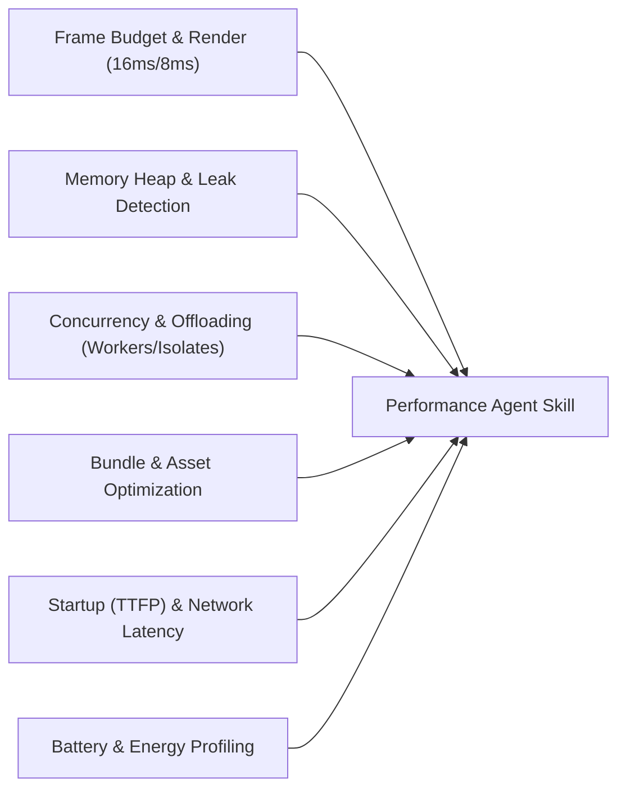

# ⚡ Performance Agent Skill Matrix & Directives

## 🎯 Capacidades de la Habilidad



---

## 📋 Protocolo de Auditoría de Rendimiento (`$performance:audit`)

El agente ejecuta el protocolo de 5 fases en orden estricto:

### 1. Detección y Mapeo del Stack
- Identificar runtime y plataforma activa del proyecto (`Flutter`, `Android`, `iOS`, `Web`, `Node/Go/Python/Rust Backend`).
- Cargar el adaptador correspondiente desde `adapters/<plataforma>.md`.

### 2. Auditoría de Assets & Bundle Budget
- Inspeccionar el directorio de recursos/estáticos (`assets/`, `public/`, `res/`).
- Detectar imágenes sin comprimir, formatos obsoletos (PNG/JPG pesados vs WebP/AVIF/SVG), fuentes completas sin subsetting y dependencias infladas.
- Verificar si existen cargas monolíticas en el arranque en lugar de lazy loading.

### 3. Auditoría Estática de Renderizado & Concurrencia
- **UI & Main Thread**: Buscar operaciones síncronas de I/O, parsing de JSON masivo o criptografía ejecutadas en el hilo principal.
- **Árbol de Componentes**: Identificar recomposiciones/re-renders descontrolados, listeners globales sin debounce, falta de memoización o ausencia de fronteras de repintado (`RepaintBoundary`, `React.memo`, etc.).

### 4. Auditoría de Memoria y Ciclo de Vida
- Rastrear suscripciones a streams/eventos, timers y controladores sin disposición explícita (`dispose()`, `cancel()`, `cleanup()`).
- Identificar retención de imágenes en cache con límites no acotados o memory spikes recurrentes en transiciones de pantalla.

### 5. Generación de Plan de Mitigación y Presupuesto
- Clasificar los cuellos de botella por impacto y esfuerzo.
- Establecer métricas esperadas de **Antes** y **Después**.
- Persistir los hallazgos en `overview/work/skill/performance.md`.

---

## 🧭 Matriz de Decisión y Diagnóstico por Síntoma

| Síntoma Observado | Causa Raíz Probable | Vector de Diagnóstico | Acción Primaria Recomendada |
|---|---|---|---|
| **Jank / Caída de FPS al hacer scroll** | Layout thrashing / Rebuilds excesivos en listas | Render & UI Thread | Implementar listas virtualizadas con reciclaje, memoización y claves estables |
| **Pico de memoria al abrir pantallas con imágenes** | Carga de bitmaps en resolución completa sin downsampling | Memory Heap | Forzar decode en resolución de display y limitar cache global |
| **UI congelada momentáneamente al recibir datos** | Parsing JSON pesado o cómputo en main thread | Concurrency | Trasladar deserialización a worker / isolate / background thread |
| **Tiempo de arranque (Startup) lento** | Inicialización ansiosa (eager) de SDKs y servicios | Startup & Init | Diferir inicializaciones no esenciales a background o post-render |
| **Crecimiento continuo de RAM con el uso (Leak)** | Listeners, timers o callbacks reteniéndose en closures | Memory Leak | Auditar ciclo de vida y garantizar desuscripción en el desmontaje |
| **Consumo excesivo de batería en segundo plano** | Polling continuo o wake-locks no liberados | Energy & Network | Reemplazar polling por Push / WebSockets / Background Schedulers |

---

## 📊 Presupuestos Operativos Canónicos (Performance Budgets)

| Dimensión | Límite Objetivo (Excelente) | Umbral de Alerta (Warning) | Acción Requerida |
|---|---|---|---|
| **Frame Time (60 FPS)** | ≤ 16.6 ms por frame | > 16.6 ms (Jank esporádico) | Aislar repintados y diferir trabajo |
| **Frame Time (120 FPS ProMotion)** | ≤ 8.3 ms por frame | > 8.3 ms | Optimizar shader compilations y layouts |
| **Cold Startup (Mobile)** | ≤ 1.5 s hasta TTFP | > 2.5 s | Lazy init de servicios |
| **Time to Interactive (Web TTI)** | ≤ 2.0 s en red 4G | > 3.5 s | Code-splitting y critical CSS |
| **Memory Growth por Pantalla** | Delta neto ≤ 5 MB post-recolección | Delta acumulativo > 20 MB | Profiling de retención de closures |
| **Bundle Size Inicial (Web/App)** | ≤ 200 KB gzip (Web) / ≤ 25 MB (App) | Crecimiento > 15% por release | Tree-shaking y assets optimizados |

---

## 📝 Persistencia y Salida Activa (`overview/work/skill/performance.md`)

Al ejecutar esta skill (mediante `$performance`, `$performance:audit` o perfiles de plataforma), es **obligatorio crear o actualizar su reporte activo** en la ruta:

`overview/work/skill/performance.md`

### Estructura Canónica del Reporte:

```markdown
# 📋 Registro Activo de Rendimiento y Memoria — Performance Agent Skill

> **Generado por**: `performance-agent-skill` (`$performance:audit`)  
> **Última actualización**: YYYY-MM-DD  

## 🎯 Tareas de Optimización Accionables

| ID | Tipo | Estado | Resumen | Evidencia/Ruta | Acción Requerida |
|---|---|---|---|---|---|
| PERF-01 | Render | Pendiente | 45ms frame time al scrollear lista | `src/views/FeedView` | Virtualizar lista y añadir frontera de repintado |
| PERF-02 | Memory | Pendiente | 80MB bitmap no liberado | `src/components/Gallery` | Aplicar downsampling en decodificación |

## 📊 Presupuesto y Mediciones (Antes vs Después)

- **PERF-01**: Frame time antes: `45ms` → Objetivo: `≤12ms`.
- **PERF-02**: Consumo heap antes: `140MB` → Objetivo: `≤45MB`.

## 📝 Observaciones y Notas de Profiling
- Análisis detallado del perfilador de la plataforma y trazas obtenidas.
```
