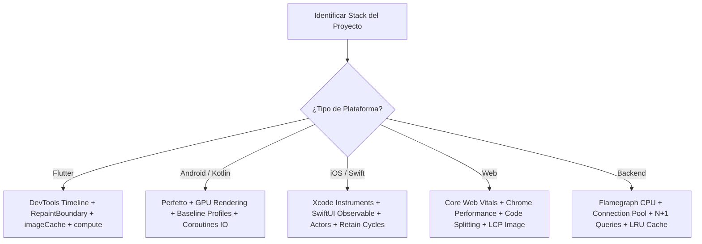

# 🧠 Engine de Rendimiento y Memoria (Performance Brain)

## 🧭 Matriz de Decisiones ("Si X → Entonces Y")

| Si se detecta... | Causa probable... | Entonces la acción obligatoria es... |
|---|---|---|
| **Caída de frames (Jank) sostenida al scrollear** | Renderizado excesivo / Layout Thrashing / Falta de reciclaje | 1. Virtualizar lista. 2. Aislar repintado con fronteras (`RepaintBoundary`/`memo`). 3. Eliminar operaciones de layout complejas del hot-path. |
| **Pico súbito de memoria (Spike) al navegar** | Carga de imágenes sin downsampling / Decodificación masiva | 1. Forzar tamaño de decode en el loader de imágenes. 2. Acotar tamaño máximo de cache en memoria. 3. Liberar recursos de pantalla saliente. |
| **Crecimiento continuo de RAM (Memory Leak)** | Retención de closures / Listeners / Timers sin cancelar | 1. Inspeccionar árbol de referencias vivas. 2. Garantizar `dispose()` o desuscripción en el ciclo de vida del componente. 3. Reemplazar referencias fuertes por débiles (`weak`). |
| **UI congelada (Freeze / Hang) durante I/O o cálculo** | Trabajo pesado ejecutado sincrónicamente en Main Thread | 1. Trasladar parsing/crypto a worker / isolate / background task. 2. Fragmentar tareas largas (`yield`/chunking). |
| **Tiempo de arranque (Startup) elevado** | Inicialización monolítica e inmediata de dependencias | 1. Convertir módulos a inicialización diferida (Lazy initialization). 2. Remover blocking calls en la fase pre-render. |
| **Consumo desmedido de batería / CPU en background** | Polling continuo / WakeLocks / Timers activos en segundo plano | 1. Detener temporizadores al pasar a background. 2. Reemplazar polling por eventos push o schedulers nativos del SO. |

---

## 🚦 Matriz de Priorización de Cuellos de Botella

1. **🔴 Prioridad CRÍTICA (Bloqueante / Crash Inminente)**:
   - Fugas de memoria acumulativas que provocan Out-Of-Memory (OOM / Jetsam kill).
   - Bloqueo total del hilo principal > 500ms (ANR / App Freeze / Deadlock).
   - *Acción*: Resolver de inmediato antes de cualquier nueva funcionalidad.

2. **🟡 Prioridad ALTA (Degradación Severa de UX)**:
   - Frame rate inestable con caídas sistemáticas por debajo de 30 FPS en scrolling interactivo.
   - Startup time > 3 segundos en dispositivos estándar.
   - Largest Contentful Paint (LCP) > 4.0s o INP > 500ms en Web.
   - *Acción*: Registrar como tarea de optimización en la sesión actual.

3. **🟢 Prioridad MEDIA (Eficiencia y Deuda Técnica)**:
   - Assets no optimizados inflando el bundle más de un 20% del presupuesto.
   - Consultas N+1 en endpoints no críticos.
   - Falta de memoización en componentes de baja frecuencia de actualización.
   - *Acción*: Registrar en `overview/work/deuda_tecnica.md` con plan de refactor.

---

## 🔀 Enrutamiento de Diagnóstico por Stack

